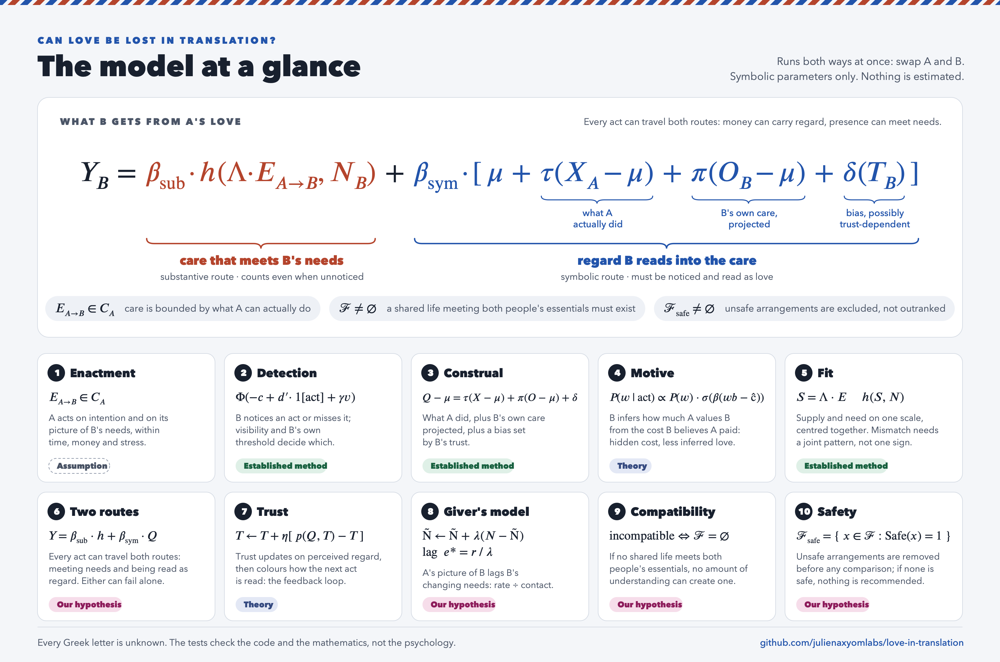

# love-in-translation

**Can love be lost in translation?** A falsification-first review of relationship science, a formal model of how care moves between two people, and a reference implementation that executes the model's mathematics.

[](https://github.com/julienaxyomlabs/love-in-translation/actions/workflows/ci.yml)


```text
H0   love intended ≠ expressed ≠ perceived ≠ received ≠ compatibility,
     and the problem is translation, not amount
───────────────────────────────────────────────────────────────────────
≠ clauses               supported, measurable, partial loss at every link
"translation, not       not supported as a general claim: amount of love and
 amount"                commitment predicts outcomes strongly; perception is
                        partly generated by the perceiver
where translation wins  invisible or ambiguous care · culturally variable
                        "currencies" (money, sacrifice, control) · wrong kind or
                        timing of support · stress-limited capacity · needs that
                        change faster than the giver's model of them
not translation at all  incompatible goals · unsustainable demands · coercion
```

> [!NOTE]
> **Audit notice (v0.3.0).** A primary-source audit of the claims this verdict and the model lean on most ([`audit/`](audit/README.md)) found no fabricated citation and no error in the equations. But four claims are overstated as used, and one sign is reversed: for judgments of a partner's love, the bias is slightly negative (r = −.11), not positive. Four of the five verdict rows below need rewording. The evidence cited against "translation, not amount" does not test that comparison, so it is open rather than settled. The recommended corrections are in [`audit/corrections.md`](audit/corrections.md) and are **not yet applied**: the paper text is still v0.2.0.

## Contents

- [Verdict by clause](#verdict-by-clause)
- [Evidence audit and study protocol](#evidence-audit-and-study-protocol)
- [Repository layout](#repository-layout)
- [Quickstart](#quickstart)
- [Model at a glance](#model-at-a-glance)
- [The model in code](#the-model-in-code)
- [Command line](#command-line)
- [Evidence as data](#evidence-as-data)
- [What has and has not been checked](#what-has-and-has-not-been-checked)
- [Challenge a claim](#challenge-a-claim)
- [Citation and licence](#citation-and-licence)

## Verdict by clause

| Clause of the hypothesis | Verdict | Anchor evidence |
|---|---|---|
| intended ≠ expressed | Supported; intentions are only inferable | Stress blocks enactment of noticed needs (Neff et al. 2021) |
| expressed ≠ perceived | Supported and quantified | Occurrence agreement κ ≈ .39; about half of sacrifices go unnoticed |
| perceived ≠ received | Supported in both directions | Invisible support helps unseen; "false-alarm" sacrifices still earn gratitude |
| received ≠ compatibility | Supported | Goal conflict harms quality regardless of understanding |
| translation, not amount | **Not supported as a general claim** | Love and commitment are among the strongest predictors of break-up (Le et al. 2010); channel matching adds little |

Full reasoning: [`paper/01-question-and-thesis.md`](paper/01-question-and-thesis.md). Closing answer to *is love enough?*: [`paper/19b-is-love-enough.md`](paper/19b-is-love-enough.md).

## Evidence audit and study protocol

v0.3.0 asks which parts of the theory can be told apart from simpler explanations using data. The framework itself stays frozen at v0.2.0.

- **[Part A: evidence audit](audit/evidence-audit.md).** The 20 claims that the verdict and the model lean on most, plus four supplementary claims, compared with their primary sources:
  - 12 were read in full text, 10 from abstracts only and 2 from press or blog accounts;
  - no citation is fabricated, and every quoted coefficient matched its source wherever the source could be read;
  - of the 20, one is supported as used, fifteen hold only with qualifications, and four are overstated: invisible support as proof of a route that bypasses perception (C04), over-provision as worse than under-provision (C06), stress "blocking" enactment (C14) and love rising as safety falls (C19);
  - one sign is reversed (C09).

  Ledger: [`audit/claims-audit.csv`](audit/claims-audit.csv).
- **[Part B: competing predictions](protocol/competing-predictions.md).**
  - These can be separated from the four rivals with realistic designs: detection, construal, inference of regard from cost, and channel match against intensity.
  - The split between the substantive and symbolic routes cannot be identified by randomisation.
  - At the level of outcomes, the symbolic route is indistinguishable from "perceived support alone".
- **[Part C: study protocol](protocol/study-protocol.md).** A dyadic longitudinal design for a Korean case study:
  - a measurement phase comes first;
  - then daily diaries in bursts over a year, a micro-randomised trial of care prompts and a vignette experiment;
  - safety works as a gate and autonomy is a separate outcome.

  **Design only: no data have been collected and no one has been recruited.**
- **[Corrections](audit/corrections.md).** 75 recommended text changes, not yet applied. The equations need none.

Overview and contents: [`audit/README.md`](audit/README.md).

## Repository layout

```text
.
├── paper/                  22 chapters, GitHub-native math ($`…`$, ```math) and figures
│   ├── README.md           table of contents
│   ├── 00-summary.md … 20-bibliography.md
│   └── figures/            model.svg (Figure 1) · model-mermaid.md (editable source)
├── audit/                  primary-source audit of 24 claims (Part A), its ledger, the corrections it implies
├── protocol/               competing predictions (Part B) and study protocol (Part C); design only
├── src/love_translation/   stdlib-only reference implementation of the formal model
├── tests/                  45 tests: the code reproduces §8's formal claims and published RSA examples
├── evidence/
│   ├── claims.jsonl        280 graded claims extracted from the paper (generated)
│   ├── references.bib      BibTeX for every cited DOI (generated)
│   ├── doi-verification.csv  Crossref resolution of every DOI (generated)
│   └── notes/              literature reviews (01–07) and audit notes (08–12)
├── tools/                  claim and audit ledgers · markdown lint · DOI check · BibTeX · paper build
├── docs/
│   ├── research-brief.md   the brief that defined the project
│   └── adr/                architecture decision records for the modelling choices
├── CORRECTIONS.md          earlier wording, fix, sources and how they were checked
└── .github/                CI (3.9–3.13 matrix), citation workflow, issue forms
```

## Quickstart

```bash
git clone https://github.com/julienaxyomlabs/love-in-translation.git
cd love-in-translation
make check          # markdown lint + both ledgers fresh + 45 tests; offline, stdlib only
pip install -e .    # optional: installs the `love-translation` CLI
make paper          # single-file build -> dist/paper.md
make dois           # re-resolve every DOI against Crossref (network)
```

No runtime dependencies. Python ≥ 3.9. `make help` lists every target.

## Model at a glance

> **Status: a structural hypothesis, not a validated model.** Every parameter below is unknown and nothing has been estimated. The unit tests check that the code implements these equations and reproduces published worked examples; they do not show that any mechanism is true. Resolving all cited DOIs shows the references point to the right works, not that each work supports every claim attributed to it.



The model runs in both directions at once (swap A and B). For care from A to B at occasion $`t`$:

```math
\begin{aligned}
&\text{(1) Enactment}     && E_{A\to B}(t) = g\big(I_{A\to B}(t),\ \tilde N_{A\to B}(t)\big), \quad E_{A\to B}(t)\in\mathcal C_A(t)\\
&\text{(2) Detection}     && \Pr\big(D_{B,k}(t)=1\big) = \Phi\big(-c_B + d'_B\,\mathbf 1[E_{A\to B,k}(t)>0] + \gamma\,v_k\big)\\
&\text{(3) Construal}     && Q_B(t)-\mu = \tau\,\big(X_A(t)-\mu\big) + \pi\,\big(O_B(t)-\mu\big) + \delta\big(T_B(t)\big) + u_B(t)\\
&\text{(4) Motive}        && \Pr(w\mid \text{act}) \propto \Pr(w)\,\sigma\big(\beta\,(w\,b-\hat c)\big)\\
&\text{(5) Fit}           && \mathbf S_B(t) = \boldsymbol\Lambda\,\mathbf E_{A\to B}(t), \qquad h(S,N) = b_0+b_1S+b_2N+b_3S^2+b_4SN+b_5N^2\\
&\text{(6) Two routes}    && \mathbf Y_B(t) = \boldsymbol\alpha + \boldsymbol\beta_{\text{sub}}\,h\big(S_B(t),N_B(t)\big) + \boldsymbol\beta_{\text{sym}}\,Q_B(t) + \boldsymbol\Gamma\,\mathbf x(t) + \mathbf e(t)\\
&\text{(7) Trust}         && T_B(t+1) = T_B(t) + \eta\,\big[p\big(Q_B(t),T_B(t)\big)-T_B(t)\big] + \varepsilon(t)\\
&\text{(8) Giver's model} && \tilde N_{A\to B}(t+1) = \tilde N_{A\to B}(t) + \lambda(t)\,\big[N_B(t)-\tilde N_{A\to B}(t)\big] + \xi(t)\\
&\text{(9) Compatibility} && \mathcal F = \big\{x\in\mathcal C_A\times\mathcal C_B : G_A(x)\ge 0,\ G_B(x)\ge 0,\ W_A(x)\ge w_A^{\min},\ W_B(x)\ge w_B^{\min}\big\}\\
&\text{(10) Safety}       && \mathcal F_{\text{safe}} = \{x\in\mathcal F : \mathrm{Safe}(x)=1\}; \ \text{outcomes are compared only within } \mathcal F_{\text{safe}}
\end{aligned}
```

Canonical version with derivations: [chapter 8](paper/08-mathematical-representation.md#model-at-a-glance).

### What each equation says, and how well it is supported

The columns keep three things apart: the statistical method (is the tool standard?), the psychological evidence (is the mechanism observed?), and what is original to this project (untested).

*Audit (v0.3.0): the psychological-evidence column overstates components 1, 5, 6 and 10. For component 3 it gives the wrong sign of bias for judgments of love. See [Tier 1 of the corrections](audit/corrections.md#tier-1-corrections-that-change-a-verdict-or-a-model-components-evidence).*

| # | In words | Statistical method | Psychological evidence | Original to this project | Details |
|---|---|---|---|---|---|
| 1 | A acts on intention and on A's picture of B's needs, but only within what A can actually do. | none needed: a constraint | Stress limits acting on needs that were noticed ([Neff, Nguyen & Williamson 2021](https://doi.org/10.1177/0146167220974490)) [Moderate/mixed] | Constraint form [Assumption] | [§8.4](paper/08-mathematical-representation.md#84-component-1-enactment-under-capacity) |
| 2 | Whether B registers an act depends on B's sensitivity and threshold, and on how visible the act is. | Signal detection as a mixed-effects probit ([DeCarlo 1998](https://doi.org/10.1037/1082-989X.3.2.186)) [Established method] | About half of sacrifices go unnoticed ([Visserman et al. 2019](https://doi.org/10.1177/1948550618757599)) [Moderate/mixed] | Visibility term $`\gamma v_k`$ [Our hypothesis] | [§8.5](paper/08-mathematical-representation.md#85-component-2-detection) |
| 3 | Perceived care tracks what A did ($`\tau`$), projects B's own care ($`\pi`$) and is shifted by a level bias ($`\delta`$). | Truth-and-bias model ([West & Kenny 2011](https://doi.org/10.1037/a0022936)) [Established method] | Projection ([Lemay, Clark & Feeney 2007](https://doi.org/10.1037/0022-3514.92.5.834)) [Moderate]; partners are accurate and positively biased at once ([Fletcher & Kerr 2010](https://doi.org/10.1037/a0019792)) [Established] | Bias that depends on trust, $`\delta(T)`$ [Our hypothesis] | [§8.6](paper/08-mathematical-representation.md#86-component-3-construal-and-motive-inference) |
| 4 | B infers how much A values B from what B believes the act cost A. | Bayesian inverse planning ([Jara-Ettinger et al. 2016](https://doi.org/10.1016/j.tics.2016.05.011)) [Established in laboratory cognition] | Value inferred from cost in laboratory tasks, including infants ([Liu et al. 2017](https://doi.org/10.1126/science.aag2132)) [Moderate, laboratory only] | Application to care; visibility of cost [Our hypothesis] | [§8.6](paper/08-mathematical-representation.md#86-component-3-construal-and-motive-inference) |
| 5 | Acts become supply on the need's own scale; the outcome is a surface over supply and need, read along $`S=N`$ and $`S=-N`$ around a shared centring point. | Polynomial regression with response surface analysis ([Edwards 2007](https://tarheels.live/jeffreyedwardswebsite/wp-content/uploads/sites/5503/2024/03/Edwards2007.pdf); [Schönbrodt, Humberg & Nestler 2018](https://doi.org/10.1002/per.2169)) [Established method] | Both under- and over-provision of support matter ([Brock & Lawrence 2009](https://doi.org/10.1037/a0015402)) [Moderate/mixed]; no care-channel surface published | Translation matrix $`\boldsymbol\Lambda`$ [Assumption] | [§8.7](paper/08-mathematical-representation.md#87-component-4-need-fulfilment-and-fit) |
| 6 | Every act can work through two routes at once: changing B's circumstances and needs (substantive) and being read as regard (symbolic). | Mediation decomposition; needs independent or randomised enactment ([Rohrer et al. 2022](https://doi.org/10.1177/25152459221095827)) [Established method, strong assumptions] | Unnoticed support helps ([Bolger, Zuckerman & Kessler 2000](https://doi.org/10.1037/0022-3514.79.6.953)) [Moderate/mixed]; income improves children's outcomes ([Cooper & Stewart 2021](https://doi.org/10.1007/s12187-020-09782-0)) [Moderate to Established] | Route split and outcome signatures [Our hypothesis] | [§8.8](paper/08-mathematical-representation.md#88-component-5-the-two-routes-our-hypothesis) |
| 7 | Trust moves toward what B currently perceives, and colours how the next act is read. | Latent state-space model ([Song & Ferrer 2009](https://doi.org/10.1080/10705510902751432)) [Established method] | Trust acts as outcome, mediator and moderator ([Wieselquist et al. 1999](https://doi.org/10.1037/0022-3514.77.5.942); [Campbell et al. 2010](https://doi.org/10.1037/a0019714)) [Moderate/mixed] | Reading function $`p(\cdot)`$; any bistability [Theoretical] | [§8.9](paper/08-mathematical-representation.md#89-component-6-dynamics) |
| 8 | A's picture of B's needs catches up at a rate $`\lambda`$ set by contact and disclosure; under steady change it lags by $`e^*=r/\lambda`$. | Error-correction learning [Established mathematics] | Fast change in adolescent autonomy needs ([Hadiwijaya et al. 2017](https://doi.org/10.1007/s10964-016-0627-7)) [indirect] | The lag model [Our hypothesis] | [§8.9](paper/08-mathematical-representation.md#89-component-6-dynamics) |
| 9 | A shared life is possible only if some arrangement meets both people's essentials without pushing either below a sustainability threshold. | Set definition | Goal conflict lowers quality regardless of understanding ([Gere & Schimmack 2013](https://doi.org/10.1007/s10902-011-9314-2)) [Moderate/mixed] | Feasibility formalisation [Our hypothesis] | [§8.10](paper/08-mathematical-representation.md#810-component-7-constraints-that-are-not-weights) |
| 10 | Unsafe arrangements are excluded before anything is compared; if none is safe, the model recommends nothing. Perceived love never enters $`\mathrm{Safe}(x)`$. | Constrained choice over $`\mathcal F_{\text{safe}}`$; no weighted sum can exclude ([Fishburn 1974](https://doi.org/10.1287/mnsc.20.11.1442)) [Established mathematics] | Felt love and commitment can rise as safety falls ([Arriaga, Capezza & Daly 2016](https://doi.org/10.1037/pspi0000035)); harms appear on dimensions separate from love ratings ([Lohmann et al. 2024](https://doi.org/10.1177/15248380231162972)) [Moderate/mixed] | Admissibility rule and its threshold [Our hypothesis; partly normative] | [§8.10](paper/08-mathematical-representation.md#810-component-7-constraints-that-are-not-weights) |

Reading the fit surface (5) needs care: $`a_1=b_1+b_2`$ is the slope along $`S=N`$ **at the centring point only**, and a negative $`a_4=b_3-b_4+b_5`$ is **not by itself** a mismatch penalty. A congruence effect needs the joint pattern $`a_4<0`$, $`a_3=0`$ and a first principal axis on $`S=N`$, with confidence intervals and model comparison ([§8.7](paper/08-mathematical-representation.md#87-component-4-need-fulfilment-and-fit)).

### Variables: definitions, units and domains

| Symbol | Meaning | Unit or scale | Domain |
|---|---|---|---|
| $`t`$; $`k`$ | occasion (diary day or panel wave); care channel (presence, talk, touch, practical help, money, …) | time step; index | $`t\in\mathbb N`$; $`k=1,\dots,K`$ |
| $`I_{A\to B}`$ | A's intention to care, by channel | self-report rating | latent, $`\ge 0`$ |
| $`\mathcal C_A(t)`$ | what A can feasibly enact (time, money, energy, stress) | channel units | subset of $`\mathbb R_{\ge0}^K`$ |
| $`E_{A\to B,k}(t)`$ | care A enacts in channel $`k`$ | minutes, currency, counts | $`\ge 0`$ |
| $`D_{B,k}(t)`$ | B registers that an act occurred | indicator | $`\{0,1\}`$ |
| $`d'_B,\ c_B`$ | B's detection sensitivity and criterion | z units | $`\mathbb R`$ |
| $`v_k,\ \gamma`$ | visibility of an act and of its cost; its effect on detection | proportion or design indicator; z units per unit of $`v`$ | $`v_k\in[0,1]`$; $`\gamma\in\mathbb R`$ |
| $`Q_B(t)`$ | B's perceived regard: feeling understood, valued, cared for | rating-scale score | bounded scale, treated as interval |
| $`X_A(t),\ O_B(t),\ \mu`$ | criterion for A's care (A's report or observer coding); B's own care given; criterion mean | same scale as $`Q`$ | same as $`Q`$ |
| $`\tau,\ \pi`$ | truth force and projection force | dimensionless weights | $`\mathbb R`$, typically 0 to 1 |
| $`\delta(T)`$ | directional (level) bias, possibly dependent on trust | scale units of $`Q`$ | $`\mathbb R`$ |
| $`w`$ | the weight A places on B's welfare, as B infers it | utility weight | $`[0,1]`$ in the reference code |
| $`b,\ \hat c,\ \beta`$ | benefit of the act to B; cost B believes A paid; choice precision in B's model of A | utility units; 1/utility units for $`\beta`$ | $`b,\hat c\ge 0`$; $`\beta>0`$ |
| $`N_{B,k}(t),\ S_{B,k}(t)`$ | B's need and the supply B received in channel $`k`$ | one shared need metric, centred at the scale midpoint | bounded scale |
| $`\boldsymbol\Lambda`$ | translation from acts (channel units) to supply (need metric) | need units per channel unit | $`K\times K`$ matrix |
| $`b_0,\dots,b_5`$; $`a_1,\dots,a_5`$; $`p_{10},p_{11}`$ | polynomial coefficients; surface quantities at the centring point; first principal axis | outcome units per centred scale unit (and squares) | $`\mathbb R`$ |
| $`\mathbf Y_B(t)`$ | B's outcomes (well-being, satisfaction, …), each on its own instrument | instrument units | $`\mathbb R^m`$ |
| $`\boldsymbol\beta_{\text{sub}},\ \boldsymbol\beta_{\text{sym}},\ \boldsymbol\Gamma,\ \mathbf x(t)`$ | effects of the two routes on each outcome; covariates and their coefficients | outcome units per unit of $`h`$ or $`Q`$ | $`\mathbb R^m`$ |
| $`T_B(t),\ \eta,\ p(\cdot)`$ | B's trust in A, normalised; updating rate; trust-dependent reading of perceived regard | proportion of scale range; per step | $`T\in[0,1]`$; $`\eta\in(0,1]`$; $`p:[0,1]\to[0,1]`$ |
| $`\tilde N_{A\to B}(t),\ \lambda(t),\ r`$ | A's model of B's need; its learning rate; drift rate of B's need | need units; per step; need units per step | bounded scale; $`\lambda\in(0,1]`$; $`r\in\mathbb R`$ |
| $`G_A(x),\ G_B(x)`$ | margins on each person's essential requirements under arrangement $`x`$ | requirement-specific | $`\ge 0`$ means met |
| $`W_A(x),\ W_B(x);\ w^{\min}`$ | each person's well-being under $`x`$; sustainability thresholds | well-being scale units | $`\mathbb R`$ |
| $`\mathrm{Safe}(x)`$ | $`x`$ passes the safety criterion on validated indicators (violence, threats, coercive control, fear-based compliance) | indicator | $`\{0,1\}`$ |
| $`\mathcal F,\ \mathcal F_{\text{safe}}`$ | feasible joint arrangements; the safe subset | sets of arrangements | possibly empty |

### Assumptions and what can be identified

- $`S`$ and $`N`$ must be commensurable and centred on a shared zero; otherwise the surface quantities in (5) say nothing about fit.
- $`X`$ is another report, not the truth. $`\tau`$, $`\pi`$ and $`\delta`$ need repeated judgments plus a criterion on the same metric.
- $`d'`$ and $`c`$ describe disagreement between two reports unless an observer or an experiment supplies the criterion.
- $`\boldsymbol\beta_{\text{sub}}`$ and $`\boldsymbol\beta_{\text{sym}}`$ need enactment measured independently of the receiver, ideally randomised; observational mediation also needs no unmeasured mediator–outcome confounding.
- $`\boldsymbol\Lambda`$ has $`K^2`$ parameters and cannot be identified for a single dyad; it needs pooling with structure or randomised channels.
- $`\lambda`$ needs long paired series of A's predictions against B's reports. No such study exists.
- $`p(\cdot)`$ and any bistability are practically unidentifiable, and no study has shown bistability in relationships.
- $`\mathrm{Safe}(x)`$ uses a normative threshold. Data can show whether care compensates for danger, not where the line must be.
- The equations are explanatory hypotheses. Predictive value would have to be shown out of sample, beyond the perceptions that already predict relationship quality.

## The model in code

Each module implements one component of the formal model in [`paper/08-mathematical-representation.md`](paper/08-mathematical-representation.md). Parameters are symbolic: the package ships **no estimated psychological coefficient**, and numbers in tests are arithmetic illustrations.

| Component | Equation (paper) | Module | Evidence status |
|---|---|---|---|
| Similarity pitfalls | $`\cos(\alpha\mathbf{E},\beta\mathbf{N})=\cos(\mathbf{E},\mathbf{N})`$ (§8.3) | [`similarity.py`](src/love_translation/similarity.py) | Established mathematics |
| Fit surface | $`Y=b_0+b_1S+b_2N+b_3S^2+b_4SN+b_5N^2`$; $`a_1,\dots,a_5`$, stationary point and principal axes (§8.7) | [`fit.py`](src/love_translation/fit.py) | Established method; congruence needs a joint pattern, not one coefficient; no care-channel surface published |
| Detection | $`\Pr(D=1)=\Phi(-c+d'\,\mathbb{1}[E>0])`$ (§8.5) | [`detection.py`](src/love_translation/detection.py) | Established method |
| Truth and bias | $`Q-\mu=\tau(X-\mu)+\pi(O-\mu)+\delta`$ (§8.6) | [`truth_bias.py`](src/love_translation/truth_bias.py) | Established method |
| Motive inference | $`\Pr(a_1\mid w)=\sigma(\beta(wb-c))`$ (§8.6) | [`inference.py`](src/love_translation/inference.py) | Theoretical; never estimated on couples or families |
| Trust dynamics | $`\dot T=\eta\,[p(T)-T]`$ (§8.9) | [`trust.py`](src/love_translation/trust.py) | Theoretical; no evidence of bistability |
| Developmental lag | $`e^*=r/\lambda`$ (§8.9) | [`lag.py`](src/love_translation/lag.py) | Our hypothesis |
| Compatibility, safety | $`\mathcal{F}=\varnothing`$; $`\mathcal{F}_{\text{safe}}=\{x\in\mathcal{F}:\mathrm{Safe}(x)=1\}`$ (§8.10) | [`constraints.py`](src/love_translation/constraints.py) | Our hypothesis (formalisation); safety threshold partly normative |

Design decisions and rejected alternatives (cosine similarity, importance weighting, difference scores, "love differential equations") are recorded as ADRs in [`docs/adr/`](docs/adr/README.md).

## Command line

```console
$ love-translation cosine-demo
E = (5,3,1,2,4) expressed care, N = (4,4,2,1,5) needs, same profiles three codings
    coding   cosine  profile r
      1..5    0.959      0.770
      0..4    0.926      0.770
    -2..+2    0.763      0.770
giving a quarter of what is needed, in proportion: cosine = 1.000

$ love-translation trust --slope 10 --midpoint 0.3
reading function: logistic(slope=10, midpoint=0.3)
max p'(T) = 2.5000   (bistability needs > 1; not sufficient)
  equilibrium T* = 0.9991   stable
bistable: no

$ love-translation trust --slope 4.5 --midpoint 0.5
reading function: logistic(slope=4.5, midpoint=0.5)
max p'(T) = 1.1250   (bistability needs > 1; not sufficient)
  equilibrium T* = 0.2244   stable
  equilibrium T* = 0.5000   unstable
  equilibrium T* = 0.7756   stable
bistable: yes

$ love-translation lag --drift 0.1 --learning-rate 0.2
steady-state lag e* = r / lambda = 0.1 / 0.2 = 0.5000
simulated error after 200 steps: 0.5000

$ love-translation infer --believed-cost 0.2      # same act, cost hidden
  posterior mean weight on the receiver's welfare = 0.5867 (uniform prior on [0, 1])
$ love-translation infer --believed-cost 1.5      # same act, cost visible
  posterior mean weight on the receiver's welfare = 0.7824 (uniform prior on [0, 1])
```

Also available as `python -m love_translation …` without installing.

## Evidence as data

`evidence/claims.jsonl` is generated from the paper by `tools/extract_claims.py`; CI fails if it is stale. One JSON object per graded claim:

```json
{"id": "05.004", "chapter": "05-evidence-against-it", "heading": "…", "grade": "established",
 "tag": "Established", "text": "…", "dois": ["10.1111/j.1475-6811.2010.01285.x"], "kind": "prose"}
```

| grade | established | moderate | preliminary | theoretical | hypothesis | assumption |
|---|---:|---:|---:|---:|---:|---:|
| claims | 89 | 116 | 25 | 18 | 26 | 6 |

```bash
love-translation claims --grade hypothesis              # everything this paper invented
love-translation claims --doi 10.1037/0022-3514.92.5.834 # where one study is used
jq -r 'select(.grade=="preliminary") | .chapter' evidence/claims.jsonl | sort | uniq -c
```

Field definitions and provenance for every generated file: [`evidence/README.md`](evidence/README.md).

## What has and has not been checked

| Check | What it shows | What it does **not** show |
|---|---|---|
| 45 tests (`make test`) | The code implements the stated equations; mathematical identities hold (cosine scale invariance, the 1-versus-3 equilibrium cases, $`e^*=r/\lambda`$, no finite safety weight excludes unsafe options); the RSA code reproduces published worked examples (Edwards 2007; Schönbrodt, Humberg & Nestler 2018) | That any psychological mechanism in the model is true. **Passing tests is not empirical validation.** |
| DOI resolution (`make dois`) | All 375 DOIs resolve and their registered titles and authors match the references; the 22 non-DOI sources are direct URLs | That each study supports the claim attributed to it. Many findings were checked against abstracts only; the depth for each source is tagged in [`evidence/notes/`](evidence/notes/) |
| Evidence grades | Every claim carries one of six grades; the paper's own propositions are tagged *Our hypothesis* | That the grading is beyond dispute. Challenge it with the issue form |
| Primary-source audit, v0.3.0 ([`audit/`](audit/README.md)) | For 24 consequential claims, the source was compared with the use: what was measured, design, population, limitations, whether the source supports the use. 12 were read in full text, 10 from abstracts, 2 from press or blog accounts | That the paper's other claims are right. The audit is not exhaustive: seven anchor citations were not examined. Eight of the twenty audited claims still rest on abstracts or press accounts |
| Empirical test of the model | None has been run. [`protocol/study-protocol.md`](protocol/study-protocol.md) designs one; it is not preregistered and has no ethics review | Anything about the model's validity. No data have been collected |

- **No manufactured precision.** No equation here is a validated psychological law, and nothing estimates a coefficient from data.
- **Not a diagnostic tool.** Nothing in this repository assesses a real relationship or family. Population statistics never describe individuals.
- **Corrections are logged.** Changes to what an earlier version claimed are recorded in [`CORRECTIONS.md`](CORRECTIONS.md) with the earlier wording, the sources and how deeply each source was checked.

The literature review and first draft were produced with AI-assisted research tooling and then checked as described above.

## Challenge a claim

The project exists to be falsified. Open an issue with the [**Challenge a claim**](.github/ISSUE_TEMPLATE/challenge-a-claim.yml) or [**New evidence**](.github/ISSUE_TEMPLATE/new-evidence.yml) form, or send a pull request. See [`CONTRIBUTING.md`](CONTRIBUTING.md) for the evidence rules.

## Citation and licence

Cite with [`CITATION.cff`](CITATION.cff) (GitHub's *Cite this repository* button reads it). Code is under the [MIT licence](LICENSE); the paper, notes, figures and data are under [CC BY 4.0](LICENSE-CONTENT.md).
