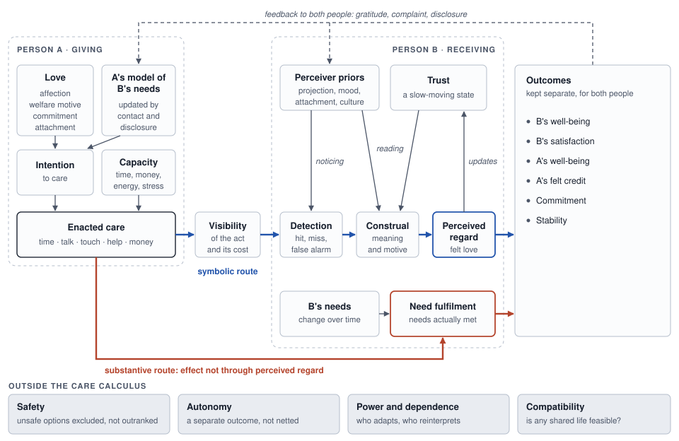

# 7. A revised conceptual model

## Auditing the ten candidate stages

The [brief](../docs/research-brief.md) proposed a ten-stage process. The audit below keeps most stages, splits two, re-specifies one as a parallel route, and adds four elements the evidence demands. Unobservable stages are flagged because they constrain what can be estimated.

| Proposed stage | Justified? | Existing theory | Observable? | Verdict |
|---|---|---|---|---|
| Internal state | Yes, but plural | Love components ([Sternberg 1986](https://doi.org/10.1037/0033-295X.93.2.119); [Berscheid 2010](https://doi.org/10.1146/annurev.psych.093008.100318)); communal motivation | Latent; self-report by component | **Keep as a vector of love components**, never one number |
| Intention | Yes | Communal motivation; compassionate love | Latent; only inferable ([Perilloux & Kurzban 2015](https://doi.org/10.1177/0956797614555727)) | **Keep**; act-specific and partly redundant with motivation |
| Behaviour | Yes | Support coding; relationship maintenance | Yes (diaries, observers) | **Keep as enacted care by channel**; **add capacity** before it |
| Observable signal | Yes | Invisible support; providing as unseen involvement ([Christiansen & Palkovitz 2001](https://doi.org/10.1177/019251301022001004)) | Partly | **Keep as visibility of the act and of its cost** |
| Perception | Yes, but two different things | Quasi-signal detection; attribution | Yes (receiver report) | **Split into detection** (did it happen?) **and construal** (what did it mean, and why was it done?) |
| Interpretation | Yes | Attribution; motive inference ([Visserman et al. 2018](https://doi.org/10.1037/emo0000344)) | Self-report | **Merge into construal and motive inference** |
| Need relevance | Yes, but misplaced | Optimal matching; need fulfilment | Self-report on a commensurate metric | **Re-specify as need fulfilment, which may act without passing through perceived regard** (substantive route; a hypothesis) |
| Experienced responsiveness | Yes | Perceived responsiveness | Self-report (two valence factors; [Crasta et al. 2021](https://doi.org/10.1037/pas0000986)) | **Keep as perceived regard** (symbolic route) |
| Relationship outcome | Yes, but not one outcome | Many | Yes | **Replace with a vector of separate outcomes** for both people |
| Feedback | Yes | Mutual cyclical growth; child effects; gratitude | Over time | **Make two-way and multi-target** |

Four additions are required by the evidence:
1. **Capacity** (time, money, energy, skill, stress), which explains care intended but not enacted.
2. **Perceiver priors** (projection, sentiment, attachment, expectations, culture, trust), which act as inputs to detection and construal rather than random noise.
3. **The giver's model of the receiver's needs**, which drives targeting and must update as needs change.
4. **A structural layer** of power and dependence, together with four constraints that sit outside the care calculus: safety, autonomy, the giver's sustainability, and compatibility.

Two redundancies must be acknowledged. In self-report, "perception", "experienced responsiveness" and "need fulfilment" all load heavily on global sentiment. In the PRI, respondents separate responsiveness from insensitivity rather than understanding from validation from caring ([Crasta et al. 2021](https://doi.org/10.1037/pas0000986); [Kim et al. 2026](https://doi.org/10.1371/journal.pone.0342451)). These stages are distinct conceptually but may not be fully separable with current self-report instruments. The model keeps them distinct because different *designs* can separate them, such as invisible-support diaries, observer coding and standardized messages.

## The causal order is not a one-way chain

The evidence rules out a strictly linear pipeline from A to B, and the model therefore includes four classes of backward and cross-cutting arrows:
- **Perception shapes what is noticed.** Sentiment, trust and attachment change detection and construal ([Hawkins, Carrère & Gottman 2002](https://doi.org/10.1111/j.1741-3737.2002.00193.x); [Collins & Feeney 2004](https://doi.org/10.1037/0022-3514.87.3.363)).
- **Expectations act on both ends.** They shape expression, for example through rejection-sensitive behaviour that elicits rejection ([Downey et al. 1998](https://doi.org/10.1037/0022-3514.75.2.545)), and interpretation ([Fincham et al. 1995](https://doi.org/10.1037/0893-3200.9.1.3)).
- **Prior experience changes later action.** Projected perceptions predict later changes in one's own responsiveness ([Lemay & Clark 2008](https://doi.org/10.1037/0022-3514.94.4.647)), and children's behaviour elicits parenting ([Rothenberg et al. 2020](https://doi.org/10.1017/s0954579419001214)).
- **Both people send and receive at once.** Gratitude benefits the benefactor ([Algoe, Gable & Maisel 2010](https://doi.org/10.1111/j.1475-6811.2010.01273.x)) [Moderate/mixed], and on days their sacrifice went undetected, givers reported slightly lower satisfaction, significant in one of two samples ([Visserman et al. 2019](https://doi.org/10.1177/1948550618757599)) [Preliminary].

Four alternative causal models were considered:
1. *Perception-first*: perceived regard drives behaviour more than behaviour drives perception, as projection and self-fulfilling expectations suggest.
2. *Sentiment-first*: global love or satisfaction drives both reported behaviour and reported perception, as sentiment override and the general sentiment factor suggest.
3. *Structure-first*: dependence, alternatives and power determine both expression and staying, as the investment model and abuse research suggest.
4. *Child-effects-first* (in families): the receiver's state elicits the giver's behaviour.

The revised model does not choose among them. It includes all of these arrows, so that their relative strength becomes an empirical question that the designs in Sections 17–18 can answer.

## Two routes by which care acts [Our hypothesis]

The model distinguishes two routes from enacted care to outcomes. **The routes are pathways of effect, not kinds of acts**: the same act can travel both. Money can change circumstances and also communicate devotion; presence can meet a real need for company, co-regulation or being known whether or not it is read as love, and can also signal regard.
- **Substantive route.** An act changes the receiver's circumstances, capacities or need states, and part of its effect does not pass through perceived regard. This does not require the receiver to miss the act. That the route operates in close relationships is [Our hypothesis]. No audited study shows a benefit that bypasses perceived regard. The invisible-support diary pattern ([Bolger, Zuckerman & Kessler 2000](https://doi.org/10.1037/0022-3514.79.6.953)) did not replicate in the same group's larger study ([Shrout et al. 2010](https://doi.org/10.1093/acprof:oso/9780195380170.003.0007)), and the laboratory benefit of invisible support ran through a perception ([Bolger & Amarel 2007](https://doi.org/10.1037/0022-3514.92.3.458)); a failed replication of one result removes the main evidence for the route without refuting it [Moderate/mixed]. Exogenous household income improved some children's outcomes, conduct symptoms, and schooling and minor-crime arrests mainly in previously poor households, but no study measured whether children read it as care, and Akee et al. attribute part of the effect to improved parenting ([Akee et al. 2010](https://doi.org/10.1257/app.2.1.86); [Cooper & Stewart 2021](https://doi.org/10.1007/s12187-020-09782-0)) [Moderate]. One study not examined in the audit reports invisible support predicting goal achievement over a year ([Girme, Overall & Simpson 2013](https://doi.org/10.1177/0146167213497802)) [Preliminary].
- **Symbolic route.** An act is read as information about how much the giver values the receiver, and its effects run through perceived regard. Evidence: same-day gratitude was associated with perceiving a sacrifice whether or not the partner reported one ([Visserman et al. 2019](https://doi.org/10.1177/1948550618757599)) [Moderate/mixed], and perceived acceptance correlated with self-reported adjustment in every study of a 43-study meta-analysis (r = .51 for children, .46 for adults; usually the same respondent) ([Khaleque & Rohner 2002](https://doi.org/10.1111/j.1741-3737.2002.00054.x)) [Established association; consistent with, not a test of, a symbolic route].

The original contribution is the claim that the two routes have **different outcome signatures** and can **succeed or fail independently for the same act** [Our hypothesis]:
- The substantive route should show mainly in material, behavioural and educational outcomes. Casino income reduced children's conduct problems but not anxiety or depression ([Costello et al. 2003](https://doi.org/10.1001/jama.290.15.2023)) [Moderate; one rural US natural experiment; abstract-level check].
- The symbolic route should show mainly in emotional well-being and relationship evaluation. A related finding classifies acts rather than routes: perceived emotional support, but not perceived financial support, was uniquely associated with adolescent distress in four countries ([Chentsova Dutton, Choi & Choi 2020](https://doi.org/10.3389/fpsyg.2020.00353); cross-sectional, weak financial-support scale) [Preliminary]. It is consistent with the route distinction but cannot test it, because each kind of support can act through both routes.

The routes are not independent in reality. Income can improve children's emotional health by improving parents' relationships ([Akee et al. 2018](https://doi.org/10.1257/aer.20160133)). In laboratory experiments with strangers, visible support turned the symbolic route negative when it signalled the receiver's inefficacy ([Bolger & Amarel 2007](https://doi.org/10.1037/0022-3514.92.3.458)).

## Seven sources of misalignment [Our hypothesis]

A gap between how much care one person believes they gave and how much the other experiences can have at least seven different origins. Only some of them are "translation." They call for different remedies, and the diagnostic signatures below are what make the typology testable.

| Type | Definition | Diagnostic signature | Evidence anchor | Remedy class |
|---|---|---|---|---|
| 0. Amount deficit (not translation) | Low love, commitment or communal motivation; little care intended | Giver's own love and commitment low; giver's diary shows few intended acts | [Le et al. 2010](https://doi.org/10.1111/j.1475-6811.2010.01285.x) (non-marital couples; applying it to parents is an extrapolation); [Huston et al. 2001](https://doi.org/10.1037/0022-3514.80.2.237) | Not a translation problem |
| 1. Undetected care | Care enacted but not registered | Misses: giver logs an act the receiver does not report | [Visserman et al. 2019](https://doi.org/10.1177/1948550618757599); [Bolger, Zuckerman & Kessler 2000](https://doi.org/10.1037/0022-3514.79.6.953) | Visibility, crediting, gratitude |
| 2. Misconstrued care | Care registered but its meaning or motive misread (in either direction) | Matched act rated lower by the receiver than intended; motive attributed to duty or self-interest | [Collins & Feeney 2004](https://doi.org/10.1037/0022-3514.87.3.363); [Visserman et al. 2018](https://doi.org/10.1037/emo0000344); [Lee & Kang 2018](https://doi.org/10.1007/s10826-018-1193-2) | Shared meaning, explanation of costs and motives |
| 3. Mis-targeted care | Wrong kind, wrong timing, too much, or intrusive on autonomy | Need–supply deficit or excess in a specific channel; autonomy frustration | [Cutrona et al. 2007](https://doi.org/10.1037/0893-3200.21.4.754); [Brock & Lawrence 2009](https://doi.org/10.1037/a0015402) (for excess: [Preliminary]); [Feeney & Thrush 2010](https://doi.org/10.1037/a0016961) | Learning the other's needs; asking; restraint |
| 4. Capacity-limited care | Care intended but not feasible (time, money, stress, skill) | Enactment low relative to perceived need; covaries with stress or work hours (intention itself not yet measured) | [Neff, Nguyen & Williamson 2021](https://doi.org/10.1177/0146167220974490) | Structural change; making constraints visible |
| 5. Incompatibility | No joint pattern meets both people's essential needs | Persists under accurate mutual understanding | [Gere et al. 2011](https://doi.org/10.1016/j.jrp.2011.06.010); [Gere & Schimmack 2013](https://doi.org/10.1007/s10902-011-9314-2) | Renegotiation or separation, not better translation |
| 6. Unsafe or coercive pattern | Violence, coercive control, exploitation of dependence | Fear, control, injury; the receiver's own tolerance judgments may drift toward tolerance | [Arriaga, Capezza & Daly 2016](https://doi.org/10.1037/pspi0000035); [Conroy & Crowley 2022](https://doi.org/10.1177/08862605211005149) | Safety first; outside the care calculus |

Only types 1–3 are translation in the strict sense, and type 4 is translation in a loose sense. Types 0, 5 and 6 are not translation at all. A useful corollary follows: if a "lost in translation" account of a relationship cannot specify which of types 1–4 operates and show its diagnostic signature, it is not yet an explanation.

## Diagram of the proposed model

The diagram shows one direction of care, from A to B. The full model is symmetric, with B simultaneously giving to A through the mirror-image structure, and every arrow labelled "feedback" acting on both people.



**Figure 1.** The revised model, drawn in one direction (A gives, B receives); the mirror-image structure runs from B to A at the same time. Care reaches B by two routes. On the symbolic route it must be visible, noticed and read as regard, and B's priors and trust shape both the noticing and the reading. On the substantive route it can meet B's needs without passing through perceived regard, a route whose operation in close relationships is a hypothesis. Outcomes stay separate for both people, feedback updates the giver's model and the receiver's priors, and the bottom row lists constraints that no amount of care can trade against.
Editable Mermaid source: [`figures/model-mermaid.md`](figures/model-mermaid.md).

Text version of Figure 1:

```text
 PERSON A (giver)                         PERSON B (receiver)                 OUTCOMES (kept separate)
 ----------------                         -------------------                 ------------------------
 Love components ---\                     Perceiver priors (projection,
 A's model of        >--> Intention         sentiment, attachment, culture)
   B's needs -------/        |                     |            |
                             v                     v            v
 Capacity (time, money, --> Enacted --> Visibility --> Detection --> Construal & --> Perceived regard --> B's well-being,
   stress, skill)           care         of act        (hit/miss/      motive          (SYMBOLIC route)     satisfaction;
                             |           and cost       false alarm)   inference              |              A's well-being
                             |                                            ^                    v              and felt credit;
                             |                                            |               Trust (latent) --> commitment;
                             +-----------------> Need fulfilment <-- B's changing needs                       stability
                                                 (SUBSTANTIVE route) -----------------------------------------^
 FEEDBACK (both people): outcomes --> gratitude/complaint/disclosure --> A's model of B, A's love, B's priors
 CONSTRAINTS (outside the care calculus):
   SAFETY excludes unsafe arrangements first | AUTONOMY is a separate outcome | POWER moderates who adapts and who reinterprets
   COMPATIBILITY: if no joint pattern meets both people's essential needs, no amount of care closes the gap
 SYMMETRY: B gives to A through the mirror-image structure at the same time.
```

## Established science versus original theorizing in the model

| Model element | Status |
|---|---|
| Separation of enacted, detected, perceived and received care | Established to Moderate (support, sacrifice and perception literatures) |
| Perceiver priors as inputs (projection, sentiment, attachment) | Moderate (projection, sentiment override, ambiguity-bounded attachment bias) |
| Capacity constraints between intention and enactment | Moderate (stress diary evidence); intention itself unmeasured |
| Trust as moderator, mediator and outcome | Moderate ([Wieselquist et al. 1999](https://doi.org/10.1037/0022-3514.77.5.942); [Campbell et al. 2010](https://doi.org/10.1037/a0019714)) |
| Two routes with distinct outcome signatures | **Our hypothesis** |
| Visibility of *cost* as a distinct determinant of perceived regard | **Our hypothesis**, built on a Theoretical mechanism (the naïve utility calculus) |
| The seven-type typology of misalignment | **Our hypothesis** |
| Developmental lag in the giver's model of needs | **Our hypothesis**, consistent with Theoretical expectancy-violation accounts |
| Safety as an admissibility constraint; compatibility as feasibility | **Our hypothesis** in formalization (the safety threshold is partly normative); Moderate evidence that the underlying harms are not offset by love |

---

**Navigation:** [← Competing theories](06-competing-theories.md) · [Contents](README.md) · [Mathematical representation →](08-mathematical-representation.md)
